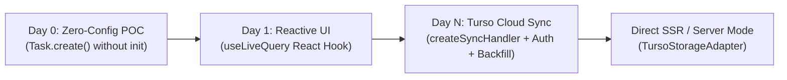

# Agentic Developer Experience

`idb-activerecord` is engineered specifically for autonomous AI agents and modern web developers. It eliminates multi-step boilerplate, offers deterministic code patterns, provides structured runtime error diagnosis, and features turnkey multi-tenant Turso cloud sync.

---

## The Day-0 to Day-N Spectrum



---

## 1. Zero-Config `Database.default` (Day-0 POC)

AI agents frequently hallucinate missing initialization steps or forget to call `db.connect()`. In `idb-activerecord`, defining an ActiveRecord model and calling any query method **automatically registers the model and lazily connects to `Database.default`**:

```ts
import { ActiveRecord } from 'idb-activerecord';

class Task extends ActiveRecord {
  static tableName = 'tasks';
}

// 0-step setup: automatically connects Database.default and provisions the store
const task = await Task.create({ title: 'Autonomous agent task' });
const allTasks = await Task.all();
```

### Global Sensible Defaults

Configure default behaviors across all models globally via `ActiveRecord.defaults`:

```ts
import { ActiveRecord } from 'idb-activerecord';

ActiveRecord.defaults = {
  timestamps: true,   // Auto-manages createdAt and updatedAt
  versioning: true,   // Auto-increments _version on create/update
  softDelete: true,   // Sets _deletedAt instead of hard deleting
  enableSync: 'auto'  // Auto-enables change tracking for sync
};
```

Explicit static properties on subclasses always take precedence over global defaults.

---

## 2. Reactive UI Hook (`idb-activerecord/react`)

The `useLiveQuery` React hook executes queries and automatically re-renders components whenever mutations occur—either locally (`create`, `update`, `destroy`, `restore`) or remotely via background sync:

```tsx
import React from 'react';
import { useLiveQuery } from 'idb-activerecord/react';
import { Task } from './models/task';

export function TaskList() {
  // Safe for Server-Side Rendering (SSR) — never touches IndexedDB during render
  const tasks = useLiveQuery(() => Task.where('completed', false).all(), []);

  if (!tasks) return <div>Loading tasks...</div>;

  return (
    <ul>
      {tasks.map(task => (
        <li key={task.id}>
          <span>{task.title}</span>
          <button onClick={() => task.update({ completed: true })}>Done</button>
        </li>
      ))}
    </ul>
  );
}
```

### Framework-Agnostic Reactive Store

For non-React frameworks (Svelte, Vue, Solid, vanilla JS), use `createLiveQuery`:

```ts
import { createLiveQuery } from 'idb-activerecord';

const store = createLiveQuery(() => Task.all(), { debounceMs: 50 });
const unsubscribe = store.subscribe(tasks => {
  console.log('Current tasks:', tasks);
});

// To stop listening:
unsubscribe();
```

---

## 3. Production Turso Cloud Sync (Day-N)

Scale your local offline-first app to a multi-user, multi-tenant cloud application with Turso (libSQL).

### Server Route (`createSyncHandler`)

The web-standard `createSyncHandler` runs seamlessly in Astro, Next.js App Router, Hono, Express, Fastify, and Cloudflare Workers:

::: code-group
```ts [Next.js App Router]
// src/app/api/sync/[...table]/route.ts
import { createClient } from '@libsql/client';
import { createSyncHandler } from 'idb-activerecord/server';

const client = createClient({
  url: process.env.TURSO_DATABASE_URL!,
  authToken: process.env.TURSO_AUTH_TOKEN!
});

const handler = createSyncHandler({
  client,
  basePath: '/api/sync',
  autoProvision: true,
  getSessionUser: async (req) => {
    // Session-verified multi-tenancy: extract authenticated user ID
    const authHeader = req.headers.get('Authorization');
    return authHeader ? authHeader.replace('Bearer ', '') : null; // 401 if null
  }
});

export { handler as GET, handler as POST, handler as DELETE };
```

```ts [Astro]
// src/pages/api/sync/[...table].ts
import type { APIRoute } from 'astro';
import { createClient } from '@libsql/client';
import { createSyncHandler } from 'idb-activerecord/server';

const client = createClient({
  url: import.meta.env.TURSO_DATABASE_URL,
  authToken: import.meta.env.TURSO_AUTH_TOKEN
});

export const ALL: APIRoute = createSyncHandler({
  client,
  basePath: '/api/sync',
  autoProvision: true,
  getSessionUser: async (req) => req.headers.get('x-user-id')
});
```

```ts [Hono]
// src/server.ts
import { Hono } from 'hono';
import { createClient } from '@libsql/client';
import { createSyncHandler } from 'idb-activerecord/server';

const app = new Hono();
const client = createClient({
  url: process.env.TURSO_DATABASE_URL!,
  authToken: process.env.TURSO_AUTH_TOKEN!
});

const sync = createSyncHandler({
  client,
  basePath: '/api/sync',
  autoProvision: true,
  getSessionUser: async (req) => req.headers.get('x-user-id')
});

app.all('/api/sync/*', (c) => sync(c.req.raw));
export default app;
```
:::

### Client 1-Line Setup & Local Data Backfill

```ts
import { Database } from 'idb-activerecord';
import { Task } from './models/task';

const db = new Database('app', {
  sync: {
    url: '/api/sync',
    auto: true,           // Automatic debounced push on mutation & polling
    interval: 30000,      // Poll remote every 30 seconds
    offlineQueue: true,   // Flush pending changes when browser comes back online
    getAuthHeaders: async () => ({
      Authorization: `Bearer ${localStorage.getItem('token')}`
    })
  }
});

db.registerModel(Task);
await db.connect();

// Backfill pre-existing local records created before sync was enabled:
await db.backfillSync();
```

---

## 4. Direct SSR Mode (`TursoStorageAdapter`)

In server-side rendering (SSR), API routes, background jobs, or server actions where `indexedDB` does not exist, use `TursoStorageAdapter` to run the exact same `ActiveRecord` models directly against Turso without changing code:

```ts
import { createClient } from '@libsql/client';
import { Database, ActiveRecord } from 'idb-activerecord';
import { TursoStorageAdapter } from 'idb-activerecord/turso-adapter';

export class Task extends ActiveRecord<Task> {
  static tableName = 'tasks';
}

const client = createClient({
  url: process.env.TURSO_DATABASE_URL!,
  authToken: process.env.TURSO_AUTH_TOKEN!
});

// Configure direct Turso storage without IndexedDB:
const db = new Database('app', {
  storage: new TursoStorageAdapter({ client })
});
db.registerModel(Task);
await db.connect();

// Standard ActiveRecord queries execute directly against Turso:
const tasks = await Task.where('status', 'active').all();
```

---

## 5. Bundled Agent Helpers (`idb-activerecord/agent`)

The opt-in subpath `idb-activerecord/agent` provides zero-overhead helpers for AI agents and developer tooling.

### Runtime Failure Diagnosis: `whyIsntThisWorking`

When an operation fails, pass the error to `whyIsntThisWorking` for instant diagnosis and copy-pasteable code fixes:

```ts
import { whyIsntThisWorking } from 'idb-activerecord/agent';

try {
  await Task.create({ title: 'Failing task' });
} catch (err) {
  const diagnosis = whyIsntThisWorking({ error: err });
  console.error('Problem:', diagnosis.problem);
  console.info('Solution:', diagnosis.solution);
  if (diagnosis.codeFix) {
    console.log('Fix:', diagnosis.codeFix);
  }
}
```

Recognized failure patterns:
1. **SSR missing IndexedDB:** Recommends `TursoStorageAdapter` or client lifecycle guarding.
2. **Database not connected:** Recommends `await db.connect()` or `Database.default`.
3. **401 Unauthorized:** Explains `getSessionUser` token validation and `getAuthHeaders`.
4. **Table not found:** Points to `autoProvision: true` or `static columns`.
5. **Missing tableName:** Diagnoses missing `static tableName` property.
6. **Foreign Key mismatch:** Warns when related model was not registered in `Database`.
7. **Version conflicts:** Suggests conflict resolution strategies.
8. **JSON serialization:** Suggests declaring `type: 'json'` in `static columns`.

### Deterministic Code Generation: `generateCodeFor`

```ts
import { generateCodeFor } from 'idb-activerecord/agent';

// Generate a complete model file:
const modelCode = generateCodeFor('model', { name: 'Project', table: 'projects' });

// Generate an API sync route for Next.js App Router:
const routeCode = generateCodeFor('sync-route', { framework: 'next', basePath: '/api/sync' });

// Generate client sync bootstrap:
const clientCode = generateCodeFor('client-sync', { name: 'Project', basePath: '/api/sync' });

// Generate a React live query component:
const componentCode = generateCodeFor('live-query', { name: 'Project' });
```

### Tree-Structured Introspection

```ts
import { explainDatabase, explainModel } from 'idb-activerecord/agent';

console.log(explainDatabase(db));
console.log(explainModel(Task));
```

---

## 6. Machine-Readable Agent Instructions (`llms.txt`)

`idb-activerecord` provides a root `llms.txt` following the [llmstxt.org](https://llmstxt.org) standard. Point your AI coding assistants (Cursor, Claude, Copilot, ChatGPT) directly to `llms.txt` in the root of the repository or npm package for concise, token-efficient instructions.
