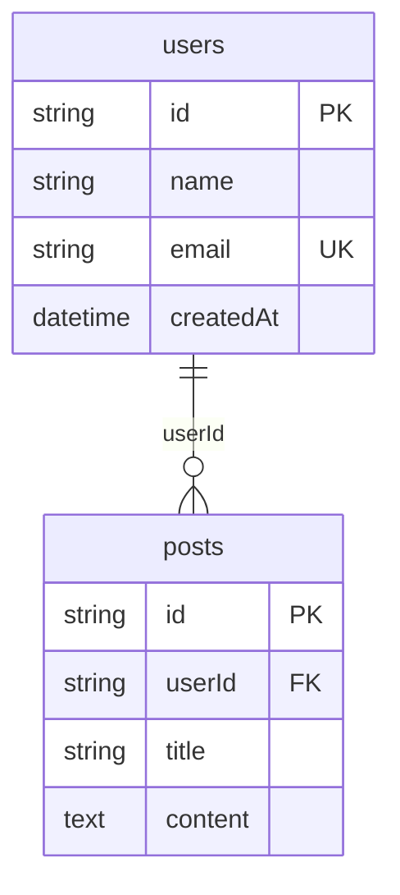

# CLI & Bidirectional ERD Tooling

`idb-activerecord` provides command-line tooling and an opt-in subpath (`idb-activerecord/erd`) for exporting production-ready SQLite/Turso DDL schemas, generating visual ERD diagrams (Mermaid.js and PlantUML), and scaffolding `ActiveRecord` model classes directly from visual diagrams.

## CLI Overview

The CLI is registered under the binary name `idb-activerecord` (via `npx idb-activerecord`).

```bash
# Display CLI version
npx idb-activerecord --version

# Display help and usage instructions
npx idb-activerecord --help
```

---

## 1. SQLite / Turso DDL Schema Exporter

Export production-ready, deterministic `CREATE TABLE IF NOT EXISTS` and `CREATE [UNIQUE] INDEX IF NOT EXISTS` statements matching `TursoAdapter` column type conventions (`INTEGER`, `REAL`, `BOOLEAN`, `JSON`, `TEXT`).

### CLI Usage

```bash
# Export SQLite DDL from a Mermaid diagram
npx idb-activerecord export-schema --input schema.mmd --format sqlite

# Export SQLite DDL with sync metadata columns (updatedAt, version, deleted_at, owner_id)
npx idb-activerecord export-schema --input ./src/db.js --sync-columns --output schema.sql

# Export structured JSON schema
npx idb-activerecord export-schema --input ./src/db.js --format json
```

### Programmatic API

Export DDL directly from a `Database` instance, an array of `ActiveRecord` subclasses, or an `ERDDocument`:

```typescript
import { exportSchemaToSQL, generateSqliteDDL, exportSchemaToJSON } from 'idb-activerecord';
import { db } from './db.js';

// Generate production SQLite DDL with sync columns
const ddl = exportSchemaToSQL(db, { syncColumns: true });
console.log(ddl);

// Or export as JSON
const jsonSchema = exportSchemaToJSON(db);
```

### Security & Sanitization
All table names, column names, and index identifiers are strictly validated against `/^[a-zA-Z_][a-zA-Z0-9_]*$/` to prevent SQL injection (CodeQL-safe).

---

## 2. Bidirectional ERD Tooling (`idb-activerecord/erd`)

The ERD module is exported via `idb-activerecord/erd` with **0 KB core bundle overhead** (tree-shaken from browser CDN bundles).

### Visual Design-First Workflow (ERD → Models)

1. Design your database schema visually using Mermaid Live Editor or a `.mmd` file.
2. Scaffold clean, type-safe `ActiveRecord` subclasses directly into your project:

```bash
npx idb-activerecord erd generate-models --input schema.mmd --output ./src/models --lang ts --sync
```

#### Example Mermaid ERD (`schema.mmd`)



#### Generated TypeScript Model (`src/models/user.ts`)

```typescript
// Generated by idb-activerecord ERD scaffolding
import { ActiveRecord } from 'idb-activerecord';

export interface UserAttributes {
  id?: string;
  name: string;
  email?: string;
  createdAt?: Date | string;
}

export class User extends ActiveRecord<User> {
  static tableName = 'users';
  static enableSync = true;

  static columns = [
    { name: 'id', type: 'string', primaryKey: true },
    { name: 'name', type: 'string' },
    { name: 'email', type: 'string', unique: true },
    { name: 'createdAt', type: 'datetime' },
  ];

  static indexes = [
    { columns: ['email'], unique: true },
  ];

  static hasMany = {
    posts: 'posts',
  };

  declare id: string;
  declare name: string;
  declare email?: string;
  declare createdAt?: Date | string;
}
```

### Documentation Workflow (Models → ERD)

Generate visual diagrams from existing model code for your documentation, GitHub READMEs, and architecture reviews:

```bash
# Generate Mermaid.js erDiagram
npx idb-activerecord erd generate --input ./src/db.js --format mermaid

# Generate PlantUML entity diagram
npx idb-activerecord erd generate --input ./src/db.js --format plantuml --output docs/erd.puml
```

### Programmatic ERD API

```typescript
import {
  generateERD,
  exportToMermaid,
  exportToPlantUML,
  exportToSQL,
  parseMermaid,
  generateModels,
  writeModelsToDisk
} from 'idb-activerecord/erd';
import { db } from './db.js';

// 1. Model -> ERD
const erd = generateERD(db);

// 2. Export to Mermaid Markdown
const mermaidDiagram = exportToMermaid(erd);

// 3. Export to PlantUML
const plantUml = exportToPlantUML(erd);

// 4. Parse Mermaid -> ERDDocument (linear-time, zero-backtracking)
const parsed = parseMermaid(mermaidDiagram);

// 5. Scaffold model files into a Map<filename, sourceCode>
const modelMap = generateModels(parsed, { language: 'typescript', includeSync: true });

// 6. Write models to disk safely (path-traversal protected)
await writeModelsToDisk(parsed, { outputDir: './src/models', language: 'typescript' });
```

---

## 3. Dual CommonJS (CJS) & ESM Support

`idb-activerecord` publishes both pure ES modules and bundled CommonJS targets with full TypeScript type declarations.

### ESM (Modern Bundlers, Vite, Next.js, Node.js):
```javascript
import { ActiveRecord, Database } from 'idb-activerecord';
import { generateERD } from 'idb-activerecord/erd';
import { useLiveQuery } from 'idb-activerecord/react';
```

### CommonJS (Legacy Node.js, Jest, CJS Toolchains):
```javascript
const { ActiveRecord, Database } = require('idb-activerecord');
const { generateERD } = require('idb-activerecord/erd');
const { createSyncHandler } = require('idb-activerecord/server');
```

Note: On Node.js 20.19+ and Node.js 22+, native `require(esm)` is supported out of the box. Our dual build ensures 100% backward compatibility for all prior LTS versions and toolchains.
